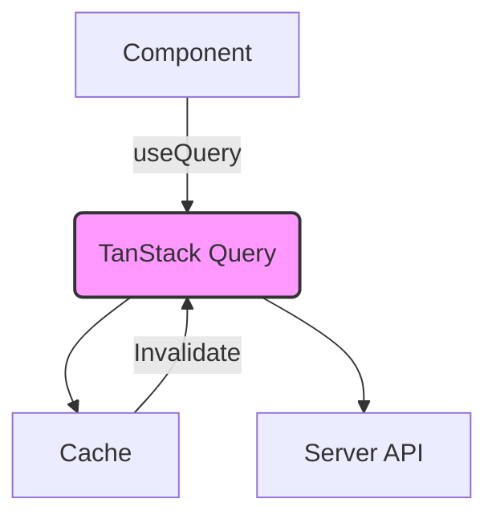

# TanStack Query & Data Fetching Learning Repository

> Yeh repo Next.js ke saath TanStack Query (previous me React Query) ko seekhne ke liye hai. Isme data fetching, caching, state management aur UI updates cover kiye gaye hain.

## 📖 Introduction

TanStack Query ek powerful library hai jo data fetching, caching, synchronization aur updates manage karta hai. Isse app ko likhna asaan hota hai aur performance better hoti hai.

Yahan hum log cover karenge:

1. **useQuery** - Data fetch karna
2. **useMutation** - Data bhejna aur state update karna
3. **Query Invalidations** - Cache clear karna jab data badlti hai
4. **Optimistic UI** - UI pe pehle update karna, fir server se confirm karna
5. **Hydration** - Server Side Rendering (SSR) mein data ko pohchana
6. **Diagram Explanations** - Mermaid diagrams se concepts visual karna
7. **Real-life Usages** - Practical examples jo aapki projects me kaam lenge

...

## 1. useQuery

```tsx
import { useQuery } from '@tanstack/react-query';

function UserProfile({ userId }) {
  const { data, isLoading, isError } = useQuery({
    queryKey: ['user', userId],
    queryFn: () => fetch(`/api/users/${userId}`).then((res) => res.json()),
  });

  if (isLoading) return <p>Loading...</p>;
  if (isError) return <p>Error loading user data.</p>;

  return <h1>{data.name}</h1>;
}
```

...

## 2. useMutation

```tsx
import { useMutation, useQueryClient } from '@tanstack/react-query';

function PostComment({ postId }) {
  const queryClient = useQueryClient();

  const { mutateAsync, isPending } = useMutation({
    mutationFn: (text) => fetch('/api/comments', {
      method: 'POST',
      body: JSON.stringify({ postId, text }),
    }).then((res) => res.json()),
    onSuccess: () => {
      // Invalidate and refetch
      queryClient.invalidateQueries({ queryKey: ['comments', postId] });
    },
  });

  return (
    <form
      onSubmit={(e) => {
        e.preventDefault();
        const text = e.target.text.value;
        mutateAsync(text);
      }}
    >
      <input name="text" />
      <button type="submit" disabled={isPending}>
        {isPending ? 'Sending...' : 'Post'}
      </button>
    </form>
  );
}
```

...

## 3. Query Invalidations

```tsx
// Manual invalidate
queryClient.invalidateQueries({ queryKey: ['users'] });

// Selective invalidate
queryClient.invalidateQueries({ queryKey: ['users'], exact: true });

// Refetch related queries
queryClient.invalidateQueries({ queryKey: ['posts'], refetchActive: true });
```

...

## 4. Optimistic UI

```tsx
// Optimistic update example
queryClient.setQueryData(['todos'], (old) => {
  return {
    ...old,
    data: [
      ...old.data,
      { id: Date.now(), text: 'New task (optimistic)', completed: false },
    ],
  };
});
```

...

## 5. Hydration (SSR)

```tsx
// app/layout.tsx
import { ReactQueryProvider } from '@tanstack/react-query';

export const metadata = {
  // ...
};

export default function RootLayout({
  children,
}: {
  children: React.ReactNode;
}) {
  return (
    <html lang="en">
      <body>
        <ReactQueryProvider
          client={queryClient}
          defaultOptions={{
            queries: {
              staleTime: 60 * 1000,
              retry: 2,
            },
          }}
        >
          {children}
        </ReactQueryProvider>
      </body>
    </html>
  );
}
```

...

## 6. Diagram Explanations (Mermaid)



Is diagram se samajh aata hai ki query kaise cache aur server ke beech baat karti hai.

...

## 7. Real-life Usages

- **E-commerce product list** - Products fetch karo, cache rakho, search par naya data lao.
- **User dashboard** - Profile info fetch karo, updates optimize lagao.
- **Comment section** - Comments likhna/dekhna, automatic refresh.
- **Form submissions** - Data bhejna, success par list refresh karna.

...

## 🛠️ Setup

1. Repository clone karo:
   ```bash
   git clone https://github.com/your-org/09-state-management-data-fetching.git
   ```
2. Dependencies install karo:
   ```bash
   cd 09-state-management-data-fetching
   npm install
   # ya ya
   pnpm install
   ```
3. Dev server shuru karo:
   ```bash
   npm run dev
   ```

## 📚 Learn More

- [TanStack Query Documentation](https://tanstack.com/query/v4)
- [Next.js Documentation](https://nextjs.org/docs)
- [TanStack Query Blog](https://tanstack.com/blog)

---

Bana raho, seekh raho aur apne projects mein apply karo! 🚀
