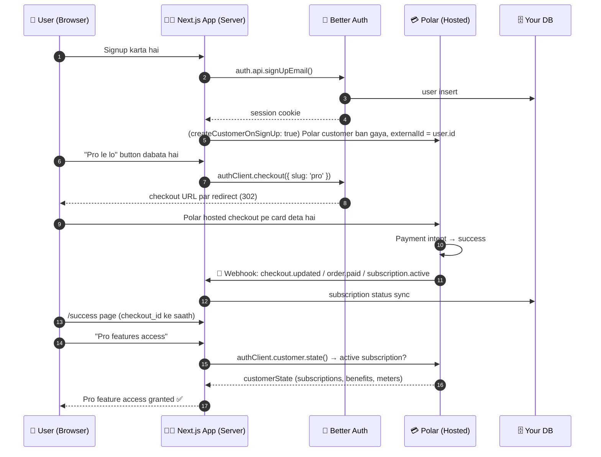
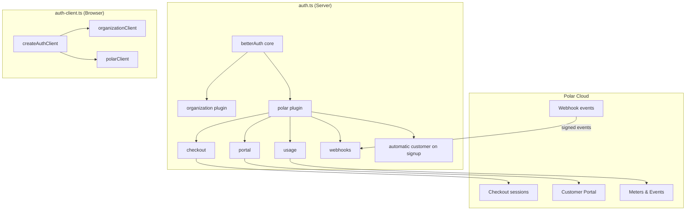
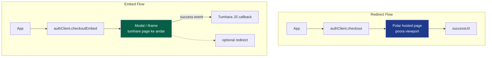
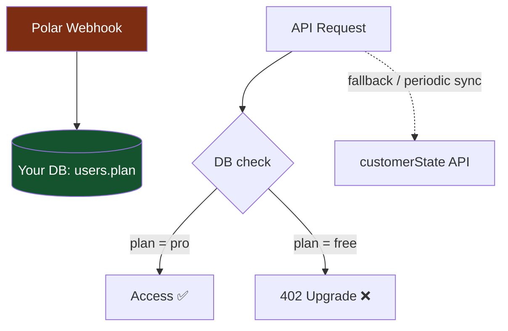
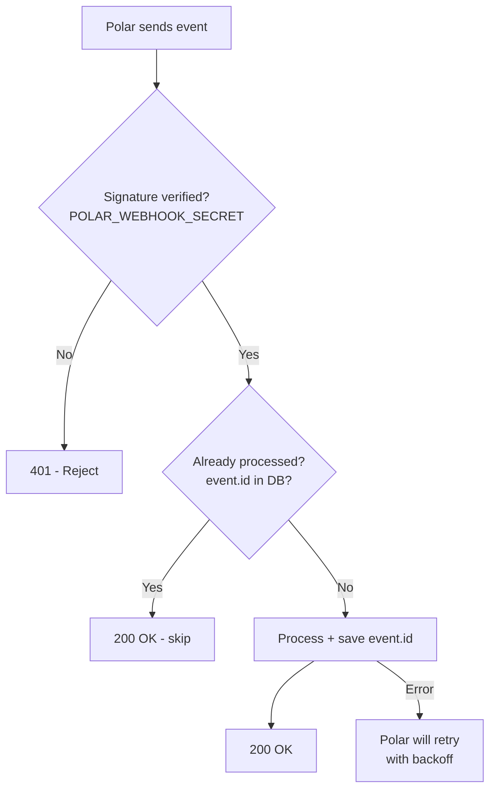
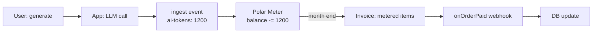
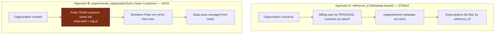

# 💳 Polar × Better Auth — Next.js Learning Repo (Hinglish Edition)

> **Ek complete playbook**: Polar payments + Better Auth authentication ko Next.js (App Router) me kaise integrate karte hain — architecture diagrams, real code snippets, deep-dive concepts aur real-life business use-cases ke saath.

---

## 📚 Table of Contents

1. [Intro — Ye Repo Kya Hai](#1-intro--ye-repo-kya-hai)
2. [Polar Kya Hai?](#2-polar-kya-hai)
3. [Better Auth Kya Hai?](#3-better-auth-kya-hai)
4. [Architecture Diagrams — Kuch Bhi Samajhna Hai Toh Pehle Ye Dekho](#4-architecture-diagrams--kuch-bhi-samajhna-hai-toh-pehle-ye-dekho)
5. [Setup — Step by Step](#5-setup--step-by-step)
6. [Checkout Flow (Redirect + Embed)](#6-checkout-flow-redirect--embed)
7. [Customer Portal](#7-customer-portal)
8. [Customer State + Benefits Gating (Deep Knowledge)](#8-customer-state--benefits-gating-deep-knowledge)
9. [Webhooks — Dil Ki Dhadkan](#9-webhooks--dil-ki-dhadkan)
10. [Usage Based Billing (Meters + Events)](#10-usage-based-billing-meters--events)
11. [Organization / Team Billing](#11-organization--team-billing)
12. [Real-Life Use Cases](#12-real-life-use-cases)
13. [Deep Knowledge — Gotchas, Security, Performance](#13-deep-knowledge--gotchas-security-performance)
14. [Debugging Checklist & Common Errors](#14-debugging-checklist--common-errors)
15. [Project Structure](#15-project-structure)
16. [Roadmap of This Learning Repo](#16-roadmap-of-this-learning-repo)
17. [Resources](#17-resources)

---

## 1. Intro — Ye Repo Kya Hai

Bhai, agar tum ek **SaaS product** bana rahe ho jisme user signup ho, wo **"Pro" plan kharide**, **subscription chale**, **seat add karein** (team ke liye), aur tum unhe **feature access de paao** — toh normally tumhe ye sab khud likhna padta hai:

- Payment provider (Stripe waghera) ka SDK
- Webhook verify karna + DB me sync karna
- Auth system alag
- Subscription state alag jagah, user alag jagah → **ghatiya coordination**

Ye repo solve karta hai. Yahan do powerful cheezein ek saath jod rahe hain:

| Tool | Kaam |
|---|---|
| **[Polar](https://polar.sh)** | Merchant of Record — checkout, subscriptions, invoicing, taxes, refunds, license keys, usage-based billing, customer portal. Ek saal me Stripe + Tax handling + licensing ka kaam kar deta hai. |
| **[Better Auth](https://www.better-auth.com/)** | Developer-friendly auth — email/password, OAuth, organizations, sessions, 2FA. TypeScript-first, DB-agnostic. |
| **`@polar-sh/better-auth`** | 🔌 Official adapter jo in dono ko jodta hai. Polar ka saara logic Better Auth ke plugin system me aa jaata hai. |
| **Next.js App Router** | Route handlers, server actions, middleware — sab yahin. |

### Ye repo seekhega:

- Polar kaise kaam karta hai internally (checkout → order → subscription → benefit grant)
- Better Auth ke saath plugin system kaise extend karta hain
- Checkout (redirect aur embed dono)
- Customer Portal (user khud subscription manage kare)
- Customer State API se **feature gating** kaise karte hain
- Webhooks: event-driven architecture, **idempotency**, signature verification
- Usage-based billing (AI products ke liye 🔥)
- Organization/team billing (seats, member sync)

---

## 2. Polar Kya Hai?

Polar ek **Merchant of Record (MoR)** hai — matlab tax compliance, VAT/GST, invoicing, refunds, dunning (failed payment retry) — sab wo khud sambhalta hai. Tum sirf **product banao, price set karo, Polar URL laga do**.

### 🔑 Core Concepts (ye 7 cheezein Polar ki life hain)

```
Organization  ──►  Product  ──►  Checkout  ──►  Order / Subscription
     │                                                │
     │                                                ▼
     │                                          Benefit Grant
     │                                                │
     └──────────── Customer ◄─────────────────────────┘
```

| Concept | Matlab |
|---|---|
| **Organization** | Tumhari company. Sab kuch iske andar hota hai. Access Token bhi org ka hota hai. |
| **Customer** | Kharidne wala banda. `externalId` = Better Auth ka `user.id` (ye mapping sabse zaroori hai). Two types: `personal` aur `team`. |
| **Product** | Jaise "Pro ₹499/mo" ya "Lifetime Deal". Isme **prices** hote hain — one-time, recurring, ya metered. |
| **Checkout** | Ek payment session. Tum URL generate karo, user Polar ke hosted page pe pay kare. |
| **Order** | Ek transaction ka record (purchase ya renewal). `paid` hone pe `onOrderPaid` fire hota hai. |
| **Subscription** | Recurring billing ka state machine. Status: `active`, `trialing`, `past_due`, `paused`, `canceled`, `revoked`... |
| **Benefit** | Ye Polar ka sabse smart concept hai. Product ke saath benefit attach karo (discord access, API credits, license key) — Polar khud grant karta hai, revoke karta hai, cycle karta hai. Tumhe sirf check karna hai. |

### 🧠 Deep Knowledge: Polar ka Billing Lifecycle

```
Checkout Created ──► User pays ──► Order (status: paid)
                                     │
                     ┌───────────────┴───────────────┐
                     ▼                               ▼
              One-time purchase            Subscription created
                                              │
                              ┌───────────────┼────────────────┐
                              ▼               ▼                ▼
                          active          past_due           canceled
                              │          (card decline)         │
                              │               │                 ▼
                              ▼               ▼            revoked (benefits
                          renewal cycle    dunning            bhi hat gaye)
                           (cycled)        retries fail
                                              │
                                              ▼
                                          revoked
```

**Point ye hai**: subscription ka state tumhare app me hardcoded nahi hota — Polar **webhooks** bhejta hai, tum sirf DB me sync karo. Aur aaj kal `customerState()` call karke bhi **live** state le sakte ho (nirbhar mat bano sirf webhook pe).

---

## 3. Better Auth Kya Hai?

Ek TypeScript auth library jo Next.js me **Route Handler** ke through chalta hai. Iska sabse bada USP: **Plugin System**. Tum plugin laga do, wo apne endpoints automatically register kar deta hai `/api/auth/...` ke neeche.

```bash
pnpm add better-auth @polar-sh/better-auth @polar-sh/sdk
```

Better Auth ke kuch plugins jo hum use karenge:
- `organization()` — teams, members, invites, roles
- `polarClient()` — client side me Polar methods unlock karta hai (`authClient.checkout()`, `authClient.customer.state()` etc.)

---

## 4. Architecture Diagrams — Kuch Bhi Samajhna Hai Toh Pehle Ye Dekho

### 4.1 Overall System Flow



### 4.2 Better Auth ke andar Plugin Architecture



> **Samjho**: Polar ka poora server-side logic `polar()` plugin ke andar rehta hai. Client pe sirf `polarClient()` lagao — wo magic se saare relevant endpoints `authClient` pe attach kar deta hai. Bina `polarClient()` ke `authClient.checkout` hota hi nahi.

### 4.3 Webhook Trust Boundary

```mermaid
graph LR
    P[Polar Cloud] -->|HTTPS POST + HMAC signature| R[Route: /api/auth/polar/webhooks]
    R --> V{Signature verify<br/>POLAR_WEBHOOK_SECRET se}
    V -->|✅ Valid| H[onOrderPaid / onSubscriptionActive...]
    V -->|❌ Invalid| X[401 Reject]
    H --> DB[(Your DB / Cache)]
    H -.->|idempotency check| DB2[(Already processed?<br/>skip karo])]
```

**Rule #1**: Kabhi bhi client se "main Pro user hoon" mat maano. Server-side hamesha Polar se verify karo.

---

## 5. Setup — Step by Step

### 5.1 Polar Dashboard

1. [polar.sh](https://polar.sh) pe signup → naya **Organization** banao
2. **Products** banao (e.g. `Pro ₹499/mo`), slug do: `pro`
3. **Settings → Access Tokens** → `POLAR_ACCESS_TOKEN` banao
4. **Sandbox vs Production**: Polar ka **sandbox environment bilkul alag hai** — products, tokens, customers sab separated. Pehle sandbox me test karo, phir production.
5. **Webhook secret** (Settings → Webhooks) → `POLAR_WEBHOOK_SECRET` copy karo

### 5.2 `.env.local`

```bash
# Polar — Production ya Sandbox, dono ka token alag hota hai!
POLAR_ACCESS_TOKEN=xxxxxxxxxxxxxxxx
POLAR_WEBHOOK_SECRET=whsec_xxxxxxxxxxxxxx

# Better Auth
BETTER_AUTH_SECRET=xxxxxxxxxxxxxxxxxxxxx
BETTER_AUTH_URL=http://localhost:3000
DATABASE_URL="file:./dev.db"   # Prisma/Drizzle/SQLite kuch bhi
```

### 5.3 Install

```bash
npx create-next-app@latest polar-learning --typescript --app
cd polar-learning
pnpm add better-auth @polar-sh/better-auth @polar-sh/sdk zod
pnpm add better-auth-client  # (agar client plugins chahiye)
```

### 5.4 Server Config — `src/lib/auth.ts`

Ye file **project ka dil** hai. Dhyan se padho:

```typescript
import { betterAuth } from 'better-auth'
import { organization } from 'better-auth/plugins'
import { polar, checkout, portal, usage, webhooks } from '@polar-sh/better-auth'
import { createPolarCore } from '@polar-sh/sdk/2026-10'

// Polar ka "core" client — service methods nahi rakhta,
// balki har SDK operation ko ye client pass hota hai (tree-shakable)
const polarClient = createPolarCore({
  accessToken: process.env.POLAR_ACCESS_TOKEN!,
  // ⚠️ Sandbox me products/tokens Production wale se BILKUL alag hote hain
  environment: 'sandbox',
})

export const auth = betterAuth({
  database: /* tumhara Prisma/Drizzle adapter */,
  emailAndPassword: { enabled: true },
  baseURL: process.env.BETTER_AUTH_URL,
  secret: process.env.BETTER_AUTH_SECRET,

  plugins: [
    organization(),

    polar({
      client: polarClient,

      // Naya user signup hote hi Polar ka customer ban jayega,
      // externalId = user.id (ye ID tumhari DB aur Polar ko link karti hai)
      createCustomerOnSignUp: true,

      // Customer creation ke waqt extra metadata bhejo
      getCustomerCreateParams: async ({ user }) => ({
        metadata: { source: 'nextjs-learning-repo', userId: user.id },
      }),

      // Kam se kam ek plugin toh do — ye required hai
      use: [
        checkout({
          // slug se checkout call karoge, Product ID yaad rakhne ki zarurat nahi
          products: [
            { productId: 'e651f46d-ac20-4f26-b769-ad088b123df2', slug: 'pro' },
            { productId: 'a1b2c3d4-ac20-4f26-b769-ad088b123df2', slug: 'lifetime' },
          ],
          successUrl: '/success?checkout_id={CHECKOUT_ID}',
          returnUrl: 'https://myapp.com', // Checkout pe "Back" button
          authenticatedUsersOnly: true,   // guest checkout band
          theme: 'dark',
        }),

        portal({
          returnUrl: 'https://myapp.com',
        }),

        usage(), // Usage Based Billing ke liye

        webhooks({
          secret: process.env.POLAR_WEBHOOK_SECRET!,
          onOrderPaid: async (payload) => {
            console.log('💰 Payment mila!', payload.data)
          },
          onSubscriptionActive: async (payload) => {
            // DB me subscription status update karo
          },
          onSubscriptionCanceled: async (payload) => {
            // Access revoke karo
          },
          // Har event ka handler hai — onPayload sab pe chalta hai
          onPayload: async (payload) => {
            // Audit log / analytics ke liye
          },
        }),
      ],
    }),
  ],
})
```

> **⚠️ Breaking change yaad rakho**: SDK v1 me request fields **`snake_case`** hain (`success_url`, `organization_id`, `discount_id`, `min_seats`), lekin **plugin configuration options camelCase** hain (`successUrl`, `returnUrl`). Confuse mat hona — ye Polar ka official migration rule hai.

### 5.5 Route Handler — `src/app/api/auth/[...all]/route.ts`

```typescript
import { auth } from '@/lib/auth'
import { toNextJsHandler } from 'better-auth/next-js'

// Ye handler saare Better Auth endpoints sambhalta hai:
// /api/auth/sign-in/email, /api/auth/sign-out, ...
// Aur Polar ke endpoints bhi isi ke andar:
// /api/auth/polar/checkout, /api/auth/polar/portal,
// /api/auth/polar/webhooks  ← webhook URL yahi hai!
export const { GET, POST } = toNextJsHandler(auth)
```

### 5.6 Client — `src/lib/auth-client.ts`

```typescript
import { createAuthClient } from 'better-auth/react'
import { polarClient } from '@polar-sh/better-auth/client'
import { organizationClient } from 'better-auth/client/plugins'

// 🧠 Yaad rakho: Saara Polar plugin logic SERVER side hota hai.
// Client pe sirf "client" variants lagte hain.
export const authClient = createAuthClient({
  plugins: [organizationClient(), polarClient()],
})
```

### 5.7 Webhook URL configure karo

Polar Dashboard → Settings → Webhooks:

```
Endpoint URL:  https://tumhara-domain.com/api/auth/polar/webhooks
```

> Localhost pe test karne ke liye **ngrok / Cloudflare Tunnel** use karo, Polar public URL maangta hai.

```bash
ngrok http 3000
# milne wala URL Polar me daal do
```

---

## 6. Checkout Flow (Redirect + Embed)

### 6.1 Redirect Checkout — Sabse Simple

```typescript
'use client'
import { authClient } from '@/lib/auth-client'

export function UpgradeButton() {
  const handleUpgrade = async () => {
    // slug 'pro' server pe configure kiya tha
    const { data, error } = await authClient.checkout({ slug: 'pro' })
    // data.url pe Polar ka hosted checkout page hai
    // redirect default true hota hai, isliye khud navigate ki zarurat nahi
  }

  return <button onClick={handleUpgrade}>⚡ Pro Plan Le Lo</button>
}
```

**Kya hota hai internally?**
1. Client → `POST /api/auth/polar/checkout`
2. Server authenticated user ki session verify karta hai
3. Polar ka checkout create hota — **customer email "lock" ho jaata hai** (user apna email change nahi kar payega)
4. IP address bhi bheja jaata hai (Better Auth ke `getIP` se) — **local currency** dikhane ke liye
5. 302 redirect → user Polar pe pay karta hai

### 6.2 Advanced Checkout — Seats, Discount, Trial

```typescript
await authClient.checkout({
  slug: 'pro',
  seats: 5,             // 5 member ka seat purchase
  discount_code: 'LAUNCH50',
  allow_trial: true,
  trial_interval: 'month',
  trial_interval_count: 1,
  success_url: '/welcome?checkout_id={CHECKOUT_ID}',
  // ⚠️ sab arguments snake_case hain
})
```

### 6.3 Embedded Checkout — Apne Page me Popup

```typescript
'use client'
export function EmbeddedCheckout() {
  const handleEmbed = async () => {
    const embed = await authClient.checkoutEmbed({ slug: 'pro' })

    embed.addEventListener('success', (event) => {
      console.log('Purchase successful!', event.detail)

      // Agar redirect false kiya, toh apna custom success UI dikhao
      if (!event.detail.redirect) {
        showConfettiAndUpgradePlan()
      }
    })
  }

  return <button onClick={handleEmbed}>Buy (inline)</button>
}
```

### 6.4 Flow Diagram — Redirect vs Embed



### 6.5 Success Page — `checkout_id` le lo

```typescript
// src/app/success/page.tsx
'use client'
import { useSearchParams } from 'next/navigation'

export default function SuccessPage() {
  const params = useSearchParams()
  const checkoutId = params.get('checkout_id')

  // ⚠️ PRO TIP: Success page pe "user Pro hai" decide mat karo.
  // Webhook kabhi kabhi 1-2 second late aata hai (race condition).
  // Hamesha customer.state() se verify karo — niche section 8.
}
```

---

## 7. Customer Portal

User khud subscription cancel kare, card update kare, invoices dekhe, benefits chalaye — **ye sab Polar ka hosted portal kar deta hai**. Tumhe khud ka billing UI likhne ki zarurat Nahi.

```typescript
'use client'
import { authClient } from '@/lib/auth-client'

export function ManageBillingButton() {
  return (
    <button
      onClick={async () => {
        await authClient.customer.portal() // Polar ke portal pe redirect
      }}
    >
      🔧 Billing Manage Karo
    </button>
  )
}
```

```typescript
// Portal URL chahiye, redirect nahi chahiye (custom UI banane ke liye)
const { data } = await authClient.customer.portal({ redirect: false })
// data.url

// Organization ke billing portal ke liye (membership server pe check hoti hai)
await authClient.customer.portal({
  fetchOptions: { query: { organizationId } },
})
```

**Real-life tip**: Settings page me "Billing" tab banao, wahan ye button. Polar ka portal tumhare brand me dikhta hai (theme option se).

---

## 8. Customer State + Benefits Gating (Deep Knowledge)

### 8.1 Customer State — Ek API, Sab Kuch

```typescript
const { data: customerState } = await authClient.customer.state()
```

`customerState` me milta hai:

```json
{
  "activeSubscriptions": [ { "status": "active", "product": { "name": "Pro" } } ],
  "grantedBenefits":     [ { "id": "...", "label": "Pro API Access" } ],
  "activeMeters":        [ { "balance": 4321, "meter": { "name": "ai-tokens" } } ],
  "customer":            { "externalId": "better-auth-user-id", "email": "..." }
}
```

Matlab **ek call me tumhe pata chalta hai**: user Pro hai? Kya-kya benefit mila hai? Kitna usage bacha hai?

### 8.2 Feature Gating Example

```typescript
// src/lib/subscription.ts
export async function getPlan(sessionUserId: string) {
  const { data: state } = await authClient.customer.state()

  const hasActiveSub = (state?.activeSubscriptions ?? []).length > 0
  const aiCreditBalance =
    state?.activeMeters?.find((m) => m.meter?.name === 'ai-tokens')?.balance ?? 0

  return {
    plan: hasActiveSub ? 'pro' : 'free',
    aiCreditBalance,
    benefits: state?.grantedBenefits ?? [],
  }
}
```

```typescript
// src/middleware.ts — Pro routes pe gate
import { NextResponse } from 'next/server'
import { auth } from '@/lib/auth'

export async function middleware(req: Request) {
  const session = await auth.api.getSession({ headers: req.headers })

  if (!session) return NextResponse.redirect(new URL('/sign-in', req.url))

  // ⚠️ Middleware me Polar API call karna har request pe slow hai.
  // Better: webhook se plan ko tumhare DB me likho, middleware me sirf DB padho.
  // Customer State ko server components / API routes me use karo.
  return NextResponse.next()
}

export const config = { matcher: ['/dashboard/:path*', '/api/premium/*'] }
```

### 8.3 🧠 Deep Dive — "DB me likho vs har baar Polar se pucho?"



**Best practice**: 
- **DB source of truth rakho** (fast, offline-friendly) — webhook se update hota rahe
- **Customer State ko reconciliation ke liye use karo** — jab user portal se khud cancel kare aur webhook miss ho jaye, tab `customer.state()` se sync kar lo
- Cache karo: Polar API har request pe mat bulao (rate limit + latency)

---

## 9. Webhooks — Dil Ki Dhadkan

### 9.1 Endpoint

```
https://tumhara-domain.com/api/auth/polar/webhooks
```

> Ye URL **Better Auth ke base path ke under** hota hai. Default base path `/api/auth` hai, toh webhook URL: `/api/auth/polar/webhooks`. Ye humne `src/app/api/auth/[...all]/route.ts` me already handle kar liya — **alag route banane ki zarurat nahi**.

### 9.2 Handlers — 40+ Events

```typescript
webhooks({
  secret: process.env.POLAR_WEBHOOK_SECRET!,

  // Har event pe chalta hai (audit log ke liye)
  onPayload: async (payload) => {
    await logToAnalytics(payload.type, payload.data)
  },

  // 💰 Ek transaction paid hui (purchase ya renewal dono)
  onOrderPaid: async (payload) => {
    const { data } = payload // order object
    await db.user.update({
      where: { id: data.customer.externalId },  // 🎯 externalId se user dhundo
      data: { lastPaymentAt: new Date(), lifetimeValue: { increment: data.amount } },
    })
  },

  onSubscriptionActive: async ({ data }) => {
    await saveSubscriptionToDB(data) // plan = 'pro'
  },

  onSubscriptionCanceled: async ({ data }) => {
    await revokeProFeatures(data.customer.externalId)
  },

  onSubscriptionPastDue: async ({ data }) => {
    await notifyUserByEmail(data.customer.email, 'Card decline ho gaya 😅')
  },

  onBenefitGrantRevoked: async ({ data }) => {
    await removeBenefitAccess(data)
  },

  onCustomerSeatClaimed: async ({ data }) => {
    // Organization me member ka seat activate hua
  },
})
```

### 9.3 🚨 Critical Rules — Ye Nahi Kiya Toh Production Me Tuttoge



1. **Idempotency (सबसे जरूरी)**: Polar ek event **kai baar bhejta hai** (network glitch, retry). Tumhare handler ko **duplicate-safe** hona chahiye:

```typescript
const processed = await db.webhookEvent.findUnique({ where: { id: payload.id } })
if (processed) return  // pehle process ho chuka — skip

await doWork(payload)
await db.webhookEvent.create({ data: { id: payload.id, type: payload.type } })
```

2. **Ordering guaranteed nahi**: `subscription.canceled` kabhi kabhi `subscription.active` se **pehle** aa sakta hai. Logic likhte waqt socho ki purana state overwrite toh nahi ho raha.

3. **Fast ACK**: Webhook handler me slow kaam (email, ML inference) mat karo. Polar timeout karega aur event retry karega. Better: **queue me daalo** (BullMQ / Inngest / QStash), turant `200` return karo.

4. **Secret hamesha verify karo**: `@polar-sh/better-auth` internally signature verify kar leta hai — lekin ye bhi jaan lo: Polar `X-Polar-Signature` header bhejta hai jo HMAC-SHA256 hai body+secret ka.

5. **Saara event naa padho**: Jo chahiye wahi handler add karo. Saare 40 events log karna matlb noise.

---

## 10. Usage Based Billing (Meters + Events)

**Ye Polar ka killer feature hai — AI/LLM products ke liye sone ka swarnika.** 🔥

Har user ko fixed credits do, usse zyada use karo toh pay karo. Ya per-call billing.

### 10.1 Setup

1. Polar Dashboard → **Meters** banao (e.g. `ai-tokens`, `file-uploads`)
2. Product me **metered price** add karo (e.g. $0.002 / token)
3. Client pe `usage()` plugin enable karo (already kiya)

### 10.2 Event Ingestion — Har Request Pe

```typescript
// src/app/api/generate/route.ts
import { authClient } from '@/lib/auth-client' // server me bhi chalega

export async function POST(req: Request) {
  const session = await auth.api.getSession({ headers: req.headers })
  if (!session) return new Response('Unauthorized', { status: 401 })

  const result = await callLLM(await req.text())

  // 🔔 Usage event ingest karo — authenticated user automatically attach hota hai
  await authClient.usage.ingest({
    event: 'ai-tokens',
    metadata: { tokensUsed: result.usage.totalTokens },
    // Organization billing hai toh:
    // organizationId,
  })

  return Response.json(result)
}
```

```typescript
// Organization seat ke context me usage attribute karo
await authClient.usage.ingest({
  event: 'ai-tokens',
  metadata: { tokensUsed: 1200 },
  organizationId, // team customer + member dono track honge
})
```

### 10.3 Balance Check — "Credits Khatam?" Screen

```typescript
const { data: customerMeters } = await authClient.usage.meters.list({
  query: { page: 1, limit: 10 },
})

// har meter me: consumedUnits, creditedUnits, balance
const tokens = customerMeters?.items?.find((m) => m.meter?.name === 'ai-tokens')
if (tokens && tokens.balance <= 0) {
  return <UpgradePrompt message="Credits khatam! Pro me 10k extra tokens." />
}
```

### 10.4 Metered Billing Ki Dhadkan



**Deep note**: Meter me **credited units** (free credits) aur **consumed units** alag dikhte hain — isse tum "10k free tokens" wala model bina code complexity ke bana sakte ho.

---

## 11. Organization / Team Billing

Agar tumhara product **teams** ke liye hai (jaise Figma, Notion) toh billing organization level pe honi chahiye, user level pe nahi.

### 11.1 Two Approaches — Ye Confusion 90% logon ko hota hai



| | `reference_id` | `experimental_organizationSync` |
|---|---|---|
| **Maturity** | Stable, purana wala | ⚠️ Experimental |
| **Billing kispe** | User ke personal Polar customer pe | Alag Polar **team customer** pe |
| **Seat management** | Khud likhna padega | Automatic (`syncSeats: true`) |
| **Kab use karo** | Existing billing app hai / simple org tagging | Naya product hai, poora billing Polar pe chahie |

> **⚠️ Warning (official docs se)**: Agar tumhare app me billing pehle se hai toh `experimental_organizationSync` **mat enable karo**. Ye existing subscriptions migrate **nahi** karta — dono jagah inconsistent state ban jaayegi (duplicate billing!).

### 11.2 Approach A — `reference_id` (Recommended shuruat ke liye)

```typescript
// Checkout ke waqt organizationId metadata me daalo
const org = (await authClient.organization.list()).data?.[0]

await authClient.checkout({
  slug: 'team-pro',
  reference_id: org.id,  // 🎯 ye org ki id hai
})

// Us org ki subscriptions nikalne ke liye
const { data: subs } = await authClient.customer.subscriptions.list({
  query: { active: true, reference_id: org.id },
})
```

**Deep note**: Ye sirf *metadata tagging* hai. Polar team-customer billing **nahi** karta, aur Better Auth ki organization membership **verify nahi** hoti — **tumhe khud verify karna hoga** ki logged-in user actually us org ka member hai.

### 11.3 Approach B — `experimental_organizationSync` + Seats

```typescript
polar({
  client: polarClient,
  createCustomerOnSignUp: true,
  experimental_organizationSync: {
    enabled: true,
    syncSeats: true, // roster ke hisaab se seats auto-size/assign
    // Har member ko har seat product mat do — custom selector
    selectSeatProductsForMember: async ({ member, user, products }) => {
      const roles = new Set(member.role.split(',').map((r) => r.trim()))
      return products
        .filter((p) =>
          p.metadata.seatAudience === 'everyone' ||
          (roles.has('admin') && p.id === ANALYTICS_PRODUCT_ID)
        )
        .map((p) => p.id)
    },
  },
  use: [checkout(), portal(), webhooks({ secret: process.env.POLAR_WEBHOOK_SECRET! })],
})
```

**Mapping table (dhayan se yaad karo):**

| Better Auth | Polar |
|---|---|
| `organization.id` | Team customer `externalId` |
| Org creator ka `user.id` | Initial owner member `externalId` |
| `organization.name` | Team customer `name` |

```typescript
// Organization checkout — hamesha explicit organizationId bhejo
await authClient.checkout({
  slug: 'team-pro',
  organization_id: org.id,  // ⚠️ snake_case
})
```

> **Better Auth roster hi source of truth hai** — Polar ke member webhooks se membership kabhi mutate mat karo (notification only hain).

---

## 12. Real-Life Use Cases

### 🧩 Use Case 1: AI Writing Tool (SaaS + Usage)

```
Setup: Product "AI Writer Pro" ₹799/mo (recurring ₹500 + metered per-token)
Flow:
  1. user signup → customer auto-created (externalId = user.id)
  2. "Upgrade" → authClient.checkout({ slug: 'ai-writer-pro' })
  3. User pays → onSubscriptionActive → DB.plan = 'pro'
  4. Har generate call pe usage.ingest({ event: 'ai-tokens', metadata })
  5. Meter balance 0 → UI pe "Credits khatam, top-up lo"
  6. Renewal failed → onSubscriptionPastDue → email reminder
```

### 🧩 Use Case 2: B2B SaaS with Team Seats (Organization Billing)

```
Setup: "Team Plan" seat-based product
Flow:
  1. Org banate hi (organizationSync enabled) Polar team customer ban jaata hai
  2. Owner checkout → organization_id bhejte hain, seats = current roster size
  3. Member add karo → seat auto-assign (immediateClaim, kyunki invite already accept ho chuka)
  4. Member leave → seat revoke → billing auto-adjust
  5. Seat product me metadata: seatAudience = 'everyone' | 'admin'
```

### 🧩 Use Case 3: Lifetime Deal + Discount Code

```typescript
// Limited time offer
await authClient.checkout({
  slug: 'lifetime',
  discount_code: 'DIWALI50',
  success_url: '/lifetime-welcome',
})
```

```
Setup: one-time product ₹4999, discount code DIWALI50
Flow: onOrderPaid → license key benefit auto-grant (Polar benefit system)
      → user ko kuch nahi karna, Polar khud benefit deta hai
```

### 🧩 Use Case 4: Agency / Freelancer — Client Billing

```
Agency apne client ke liye Polar organization banati hai.
Har client ki Better Auth organization = Polar team customer.
Client ka usage (API calls) organizationId ke saath ingest hota hai →
month-end per-client invoice Polar generate karta hai (MoR = tax compliance free).
```

### 🧩 Use Case 5: Course / Digital Product (One-time)

```
Product: "Next.js Masterclass" ₹1999 one-time
Benefit: Discord access + course material license key
Flow: checkout → onOrderPaid → Polar benefit grant → user ko Discord role mil gaya
      Portal se user invoices dekh sakta hai, download kar sakta hai.
```

### 🧩 Use Case 6: Freemium with Trial

```typescript
await authClient.checkout({
  slug: 'pro',
  allow_trial: true,
  trial_interval: 'day',
  trial_interval_count: 7,
})
```

```
Trial flow: subscription.status = 'trialing' → onSubscriptionActive fire hota hai
Trial end hone pe: card charge fail → onSubscriptionPastDue → dunning retries
              card charge success → status 'active', onSubscriptionCycled
```

---

## 13. Deep Knowledge — Gotchas, Security, Performance

### 13.1 `externalId` — Sabse Important Link

```
Better Auth user.id  ════════╗
                             ╠═════════► Polar customer.externalId
   (tumhari DB ka PK)        ║
   Polar webhook ────────────╝  →  payload.data.customer.externalId → tumhara user
```

**Webhook handler me user dhundhne ka canonical tareeka:**

```typescript
const userId = payload.data.customer.externalId
const user = await db.user.findUnique({ where: { id: userId } })
```

> Kabhi email se match mat karo (email change ho sakta hai, typos, multiple orgs).

### 13.2 Environment Confusion — #1 Beginner Mistake

```
SANDBOX  =  test products, test tokens, test customers  (totally separate DB)
PRODUCTION =  real products, real tokens, real customers

POLAR_ACCESS_TOKEN (production) ❌ kaam nahi karega sandbox me
```

Fix:

```typescript
const polarClient = createPolarCore({
  accessToken: process.env.POLAR_ACCESS_TOKEN!,
  environment:
    process.env.NODE_ENV === 'production' ? 'production' : 'sandbox',
})
```

### 13.3 camelCase vs snake_case

```typescript
// ✅ Plugin config — camelCase
checkout({ successUrl: '/success', returnUrl: 'https://x.com' })

// ✅ Client method args — snake_case (SDK v1 request models)
authClient.checkout({ success_url: '/success', organization_id: id, min_seats: 2 })
```

### 13.4 Security Checklist

| Threat | Protection |
|---|---|
| Fake "I'm Pro" claim client-side | Hamesha server-side verify (`customer.state()` ya DB synced via webhook) |
| Tampered webhook payload | `POLAR_WEBHOOK_SECRET` signature verification (plugin internally karta hai) |
| Token leak | `POLAR_ACCESS_TOKEN` sirf server env me — **kabhi** `NEXT_PUBLIC_` prefix mat do |
| IDOR (org billing access) | `organizationId` bhejne se pehle Better Auth membership check karo (adapter karta hai, lekin app-level bhi karo) |
| Over-granting | Benefits Polar se aate hain — `grantedBenefits` check karke hi access do, hardcoded bool se nahi |

### 13.5 Performance Tips

```typescript
// ❌ Har render pe Polar API mat bulao
async function Page() {
  const { data } = await authClient.customer.state() // 200-400ms latency!
  // ...
}

// ✅ Webhook-driven DB + short-lived cache
const plan = await redis.get(`plan:${userId}`) ?? await syncPlanFromPolar(userId)

// ✅ Revalidate: jab portal se user cancel kare, uska next visit sync ho jaaye
```

- **Debounce usage events**: Har token pe `ingest` mat bhejo. Buffer karo (e.g. har 5s ya 100 events), ya queue use karo.
- **Webhook queue me daalo**: `onPayload` turant `return`, background me processing.

### 13.6 Error Handling Patterns

```typescript
const { data, error } = await authClient.checkout({ slug: 'pro' })

if (error) {
  // error.status 401 = session gaya, 404 = product slug galat,
  // 400 = validation (jaise seats product me allowed nahi)
  toast.error(error.message ?? 'Checkout shuru nahi ho paya')
}
```

> Ye error **discriminated union** pattern hai — `data` ya `error`, dono me se ek hi hoga. TypeScript me narrow karna easy hai.

### 13.7 Migration / Production Launch Checklist

- [ ] Sandbox → Production token swap
- [ ] Webhook URL production domain pe configured + secret updated
- [ ] Webhook events subscribed: `order.paid`, `subscription.active/canceled/past_due`, `customer.state_changed`, `benefit.grant.revoked`
- [ ] Idempotency table bana di
- [ ] Success page race condition handle kiya (state se verify)
- [ ] `authenticatedUsersOnly: true` (guest checkout band)
- [ ] Rate limiting on checkout endpoint (spammer rokna)

---

## 14. Debugging Checklist & Common Errors

| Symptom | Root Cause | Fix |
|---|---|---|
| `authClient.checkout is not a function` | `polarClient()` plugin client pe nahi hai | `createAuthClient({ plugins: [polarClient()] })` |
| Webhook 404 | Endpoint galat URL pe hai | `/api/auth/polar/webhooks` — `[...all]` route check karo |
| Webhook 401 | Secret mismatch | `POLAR_WEBHOOK_SECRET` .env me sahi hai? Production vs sandbox? |
| Product not found | Environment mismatch | Sandbox token se production product ID nahi milega |
| Customer nahi banta signup pe | `createCustomerOnSignUp` false / user `anonymous` hai | Config check, anonymous user skip hote hain |
| Email update Polar me nahi dikha | Sync async hai | Kuch seconds lagta hai, ya manual `getStateExternalCustomers` call |
| Duplicate billing (org) | Dono approaches mix kiye | Ya `reference_id`, ya `organizationSync` — ek hi |
| Checkout URL ban raha hai lekin email editable | Unauthenticated checkout | `authenticatedUsersOnly: true` rakho |
| Seat count galat | Manual Polar portal change vs Better Auth roster conflict | `syncSeats` enabled hai toh roster hi authority hai |

```bash
# Local webhook debugging
npx ngrok http 3000
# phir Polar Dashboard me webhook URL: https://xxxx.ngrok.io/api/auth/polar/webhooks

# Better Auth debug logging
BETTER_AUTH_DEBUG=true npm run dev
```

---

## 15. Project Structure

```
polar/
├── README.md                          ← tum abhi padh rahe ho
├── src/
│   ├── app/
│   │   ├── api/
│   │   │   └── auth/
│   │   │       └── [...all]/
│   │   │           └── route.ts       ← Better Auth + Polar endpoints
│   │   ├── (marketing)/
│   │   │   ├── page.tsx               ← landing + pricing
│   │   │   └── pricing/page.tsx       ← checkout buttons
│   │   ├── (app)/
│   │   │   ├── dashboard/
│   │   │   │   └── page.tsx           ← customer.state() se plan display
│   │   │   └── settings/
│   │   │       └── billing/
│   │   │           └── page.tsx       ← portal button + invoices list
│   │   ├── success/
│   │   │   └── page.tsx               ← checkout_id handling
│   │   └── layout.tsx
│   ├── lib/
│   │   ├── auth.ts                    ← ⭐ polar plugin config
│   │   ├── auth-client.ts             ← polarClient()
│   │   ├── db.ts                      ← Prisma/Drizzle client
│   │   └── subscription.ts            ← plan helpers / caching
│   └── middleware.ts
├── prisma/ (ya drizzle/)
│   └── schema.prisma                  ← users, subscriptions, webhook_events
├── .env.local
└── package.json
```

---

## 16. Roadmap of This Learning Repo

Is repo me aage aise examples banate jao:

- [ ] **01-basic-checkout** — sabse simple redirect flow
- [ ] **02-embedded-checkout** — modal wala checkout
- [ ] **03-webhook-sync** — idempotent webhook + DB sync + ngrok setup
- [ ] **04-benefits-gating** — `customerState()` se feature access
- [ ] **05-usage-billing** — AI credits (meter + events)
- [ ] **06-organization-billing** — `reference_id` approach
- [ ] **07-team-seats** — `experimental_organizationSync` + seat management
- [ ] **08-customer-portal** — billing settings UI
- [ ] **09-license-keys** — Polar benefits se license delivery
- [ ] **10-production-checklist** — deploy to Vercel + security hardening

---

## 17. Resources

- 📖 [Polar Docs](https://docs.polar.sh)
- 🔌 [`@polar-sh/better-auth` README](https://www.npmjs.com/package/@polar-sh/better-auth) (official, in-depth)
- 🧑‍💻 [Better Auth Docs](https://www.better-auth.com/docs)
- 🎬 [Polar YouTube](https://www.youtube.com/@polar_sh)
- 💬 [Polar Discord](https://discord.gg/polar)

---

## 🙌 Closing Words

> **Polar tumhara "merchant" hai, Better Auth tumhara "bouncer" hai, aur tumhara Next.js app dono ka coordinator.**

Agar is README se kuch seekha toh ⭐ star lagao. Aur haan — pehle **sandbox** me banao, webhook **idempotency** kabhi mat bhoolna, aur `externalId` ko kabhi email se mat replace karna. Yehi teen cheezein production me sabse zyada nuksan karti hain.

Happy hacking! 🚀
